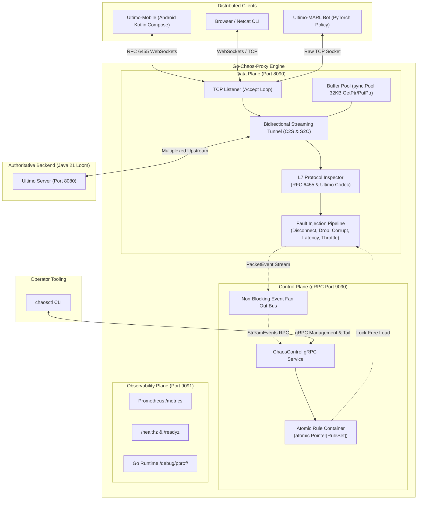

# Chaos-Proxy: High-Throughput L4/L7 Fault Injection Engine

[](https://go.dev/)
[](https://github.com/StanislawGolec/chaos-proxy)
[](#empirical-benchmark-performance)
[](#empirical-benchmark-performance)
[](https://grpc.io/)
[](#l7-protocol-awareness-and-semantic-faults)
[](LICENSE)

A high-throughput L4/L7 network proxy and chaos engineering fault-injection engine written in **Go 1.23+**. Built with an **Envoy-style separated Data Plane and Control Plane architecture**:
* **Data Plane:** Zero-allocation transparent TCP and RFC 6455 WebSocket byte stream proxying via `sync.Pool` pointer buffer recycling (`GetPtr`/`PutPtr`), sustaining **>2.1 GB/s throughput** and **sub-3 nanosecond fault evaluation** with **0 B/op** on the steady-state hot path.
* **Control Plane:** Low-latency gRPC service (`chaos.v1.ChaosControl`) backed by lock-free `atomic.Pointer` rule snapshots and non-blocking pub/sub event streaming, administered dynamically via the `chaosctl` CLI without proxy restarts.
* **Observability Plane:** Dedicated HTTP server exporting Prometheus metrics (`/metrics`), Kubernetes liveness/readiness probes (`/healthz`, `/readyz`), and live `net/http/pprof` profiling endpoints.

---

## 1. System Architecture



---

## 2. Empirical Benchmark Performance

Benchmarked on modern x86-64 hardware running Go 1.23+ under native `testing.B` profiling (`-benchmem`):

| Benchmark Operation | Iterations | Latency / op | Throughput | Heap Allocations |
| :--- | :--- | :--- | :--- | :--- |
| **Fault Evaluation (Pass-Through)** | 543,542,264 | **2.21 ns/op** | ~452M ops/s | **0 B/op (0 allocs)** |
| **Buffer Pool Parallel Access (`GetPtr`/`PutPtr`)** | 356,380,668 | **3.27 ns/op** | ~305M ops/s | **0 B/op (0 allocs)** |
| **Fault Evaluation (Drop Rule)** | 82,131,588 | **13.95 ns/op** | ~71M ops/s | **0 B/op (0 allocs)** |
| **Fault Evaluation (L7 Verb-Targeted Drop)** | 56,261,163 | **22.30 ns/op** | ~45M ops/s | **0 B/op (0 allocs)** |
| **Streaming Throughput (32KB)** | 75,303 | 15,276 ns/op | **2,145.09 MB/s** | **0 B/op (0 allocs)** |
| **WebSocket In-Place Unmasking (32KB)** | 648,826 | 1,811 ns/op | **18,096.96 MB/s** | **0 B/op (0 allocs)** |
| **Card Parser (`ParseCard`)** | 58,219,642 | **21.05 ns/op** | ~47M ops/s | **0 B/op (0 allocs)** |
| **WebSocket Frame Encode** | 53,672,782 | **22.13 ns/op** | ~45M ops/s | **16 B/op (1 alloc)** |

---

## 3. Chaos Engineering Capabilities

### L4 Network Faults
* **Latency & Jitter Injection:** Configurable base delay and jitter variance supporting both Uniform (`UNIFORM`) and Gaussian normal (`NORMAL`) distributions, with per-packet application probability ($0.0 \le P \le 1.0$) and directional filtering (`ALL`, `C2S`, `S2C`).
* **Probabilistic & Burst Packet Drops:** Discards packets according to a configurable drop ratio ($0.0 \le P \le 1.0$) or triggers deterministic multi-packet consecutive drop bursts (`--burst`) to simulate mobile dead zones and TCP retransmission timeouts.
* **Abrupt Disconnection (Hardware TCP RST) & Grace Windows:** Forces immediate socket termination with `SO_LINGER = 0` (`SetLinger(0)`) to emit hardware `TCP RST` packets without graceful `FIN` handshakes, alongside configurable reconnection grace periods (`--grace`, e.g. `120s`).
* **Bandwidth Throttling:** Thread-safe Token Bucket rate limiter pacing byte transmission per direction down to constrained mobile network speeds (e.g. `64kbps`, `1mbps`).

### L7 Protocol Awareness and Semantic Faults
* **Zero-Allocation L7 Verb-Targeted Drops:** Inspects both raw ASCII line streams and masked RFC 6455 WebSocket text frames (`Opcode 0x1`) in-place at token boundaries (`MatchesTargetVerb`) to selectively drop targeted application verbs (such as `DEFEND` or `DEFENSE_STACK`) with zero heap allocations.
* **RFC 6455 WebSocket Frame Codec:** Full binary header parser and encoder supporting FIN/RSV bits, 7-bit/16-bit/64-bit extended payload lengths, 10MB frame limits, control frames (`Ping`, `Pong`, `Close`), and 64-bit word-aligned XOR in-place unmasking (`UnmaskInPlace`).
* **Ultimo Wire Protocol Tokenizer & Semantic Fuzzer:**
  * **L4 Raw Bit-Flipper (`L4_RAW`):** Flips 1 to 3 random bits at random byte offsets within in-flight packets.
  * **L7 Semantic Fuzzer (`L7_SEMANTIC`):** Mutates valid Ultimo card tokens and command opcodes (e.g. `RED` -> `PURPLE`, `PLAY` -> `PLXX`) to verify upstream parser and anti-cheat resilience.
  * **Supported Client Commands:** `JOIN`, `START`, `PLAY`, `DRAW`, `PASS`, `PING`, `CHAT`, `ULTIMO`, `CATCH_ULTIMO`, `CHALLENGE_WILD_FOUR`, `LIST_ROOMS`, `TRANSFER_OWNERSHIP`, `KICK`, `DEFEND`.
  * **Supported Server Events:** `WELCOME`, `ROOM_STATUS`, `HAND_UPDATE`, `TOP_CARD`, `TURN_ANNOUNCED`, `OPPONENT_UPDATE`, `DRAW_RESULT`, `GAME_OVER`, `ERROR`, `PONG`, `SERVER_SHUTDOWN`, `ULTIMO_DECLARED`, `ULTIMO_PENALTY`, `CHALLENGE_RESULT`, `ROUND_OVER`, `ROOM_LIST`, `DEFENSE_STACK`, `PODIUM_STANDINGS`, `RECONNECT_SNAPSHOT`.

---

## 4. Control Plane Management (`chaosctl` CLI)

The standalone `chaosctl` CLI communicates with the proxy's gRPC control plane (`:9090`) for real-time fault orchestration and telemetry monitoring. All commands support `--grpc <addr>`, `--json` for machine-readable output, and `--no-color`.

```bash
# Inject 150ms base latency with 50ms Gaussian jitter (80% probability)
chaosctl latency --base=150ms --jitter=50ms --dist=gaussian --prob=0.8 --dir=ALL

# Drop 20% of server-to-client packets in bursts of 3
chaosctl drop --rate=0.20 --burst=3 --dir=S2C

# Selectively drop 100% of client DEFEND commands at L7
chaosctl drop --verb=DEFEND --rate=1.0 --dir=C2S

# Corrupt payloads with 5% probability using L7 semantic token mutation
chaosctl corrupt --rate=0.05 --mode=l7 --dir=ALL

# Throttle bandwidth to 64 kbps (8,000 bytes/sec)
chaosctl throttle --rate=64kbps --dir=ALL

# Trigger immediate socket teardown with TCP RST and a 120s reconnection grace window
chaosctl disconnect --tcp-reset --immediate=true --grace=120s --dir=ALL

# Apply predefined chaos testing scenarios
chaosctl scenario defense-drop
chaosctl scenario reconnect-grace

# Inspect active fault rules, uptime, active tunnels, and throughput (tabular or JSON)
chaosctl status
chaosctl status --json

# Stream real-time packet event telemetry with ANSI color highlights
chaosctl tail --dir=ALL --action=DROPPED,DELAYED

# Clear all active fault rules (revert to 100% transparent pass-through)
chaosctl reset
```

---

## 5. Observability & SRE Metrics (Port 9091)

The observability server exposes Prometheus metrics, health probes, and runtime profilers:

| Endpoint / Metric | Type | Description |
| :--- | :--- | :--- |
| `chaos_active_tunnels` | Gauge | Current number of active client-server TCP proxy tunnels |
| `chaos_packets_total{direction,action}` | CounterVec | Total packets processed by direction (`c2s`, `s2c`) and verdict (`pass`, `delay`, `drop`, `corrupt`, `disconnect`) |
| `chaos_bytes_transferred_total{direction}` | CounterVec | Total bytes transferred across client and server streams |
| `chaos_injected_latency_seconds` | Histogram | Distribution of injected latency delays (`0.005s` to `5.0s` buckets) |
| `chaos_control_plane_rule_updates_total` | Counter | Cumulative count of dynamic fault rule updates applied via gRPC |
| `GET /healthz` | HTTP Probe | Liveness probe returning `200 OK` (`{"status":"UP","component":"Go-Chaos-Proxy"}`) |
| `GET /readyz` | HTTP Probe | Readiness probe returning `200 OK` (`{"status":"READY"}`) when listeners are active |
| `GET /debug/pprof/*` | Profiler | Go runtime CPU, heap, goroutine, and execution trace profiling endpoints |

---

## 6. Repository Structure

```text
Go-Chaos-Proxy/
├── .github/workflows/ci.yml       # CI pipeline: vet, race detector, goleak, fuzzing, benchmarks, Docker build
├── api/proto/v1/chaos.proto       # Canonical Protobuf & gRPC service contract (chaos.v1)
├── cmd/
│   ├── proxy/main.go              # Proxy daemon entrypoint (Data, Control, and Observability planes)
│   └── chaosctl/                  # Operator CLI tool and unit test suite
├── internal/
│   ├── config/                    # CLI flag parsing, validation, and structured slog logging
│   ├── controlplane/              # gRPC ChaosControl server and non-blocking event broadcaster
│   ├── dataplane/                 # TCP listener, bidirectional Pipe, sync.Pool BufferPool, leak & bench tests
│   ├── engine/                    # Fault pipeline: latency, drop (L4/L7 verb), corrupt, throttle, disconnect
│   └── metrics/                   # Prometheus registry, HTTP server, /healthz, /readyz, and pprof handlers
├── pkg/
│   ├── proto/v1/                  # Generated Go Protobuf & gRPC stubs
│   └── protocol/                  # RFC 6455 WebSocket codec, Ultimo tokenizer, L7 inspector, native fuzzers
├── deployments/
│   ├── Dockerfile                 # Multi-stage distroless container build (nonroot UID 65532)
│   ├── docker-compose.yml         # E2E stack: go-chaos-proxy + mock-ultimo-server + Prometheus
│   ├── prometheus.yml             # Prometheus scrape configuration
│   └── k8s/                       # Kubernetes Deployment, Service, HPA (autoscaling/v2), and ConfigMap
├── scripts/                       # Protobuf codegen and cross-platform E2E chaos scenario runners
├── Dockerfile                     # Root multi-stage distroless build definition
└── Makefile                       # Standard build, test, race, bench, profile, and proto automation targets
```

---

## 7. Engineering Trade-Offs & Design Rationale

* **Separated Data and Control Planes:** Decoupling the raw `net.Conn` forwarding loops from the gRPC control plane ensures that administrative queries and telemetry subscribers never block socket I/O. Rule updates swap an immutable `*RuleSet` via `atomic.Pointer`, eliminating reader mutex lock contention on the packet hot path.
* **Pointer-Based `sync.Pool` Recycling (`GetPtr`/`PutPtr`):** Returning `*[]byte` pointers from `sync.Pool` avoids interface boxing allocations and prevents allocating fresh 32KB slices per connection read, maintaining `0 B/op` during high-concurrency streaming.
* **64-Bit Word In-Place WebSocket Unmasking:** RFC 6455 mandates XOR masking on client-to-server frames. Unmasking 8 bytes per instruction cycle in-place within the pooled buffer achieves **>18 GB/s** memory throughput with zero heap allocations.
* **Graceful Half-Close & Leak-Free Teardown:** Propagating `CloseWrite()` on `*net.TCPConn` upon `io.EOF` and coordinating twin directional goroutines via `context.Context` and `sync.WaitGroup` guarantees zero orphaned goroutines on connection teardown, verified via `go.uber.org/goleak`.

---

## 8. Quick Start, Testing & Deployment

### Build Binaries
```bash
go build -o bin/proxy ./cmd/proxy
go build -o bin/chaosctl ./cmd/chaosctl
```

### Run Proxy Daemon
```bash
# Listen on :8090 in L7-aware mode, proxying to localhost:8080 with gRPC on :9090 and metrics on :9091
./bin/proxy --listen :8090 --target localhost:8080 --grpc :9090 --metrics :9091 --mode l7 --log-level info
```

### Run Unit Tests, Race Detector, Fuzzing & Benchmarks
```bash
# Run all unit, integration, and goroutine leak (goleak) tests
go test -v ./...

# Run with the Go race detector enabled
go test -v -race ./...

# Run native Go protocol fuzzers (RFC 6455 frames, Ultimo commands, cards, L7 inspector)
go test -v -fuzz=FuzzReadFrame -fuzztime=10s ./pkg/protocol
go test -v -fuzz=FuzzUltimoCommandParser -fuzztime=10s ./pkg/protocol

# Run zero-allocation microbenchmarks
go test -run=NONE -bench . -benchmem ./internal/dataplane ./pkg/protocol
```

### Run End-to-End Docker Compose Stack & Chaos Scenarios
```bash
# Start Go-Chaos-Proxy, Mock Ultimo Server, and Prometheus
docker compose -f deployments/docker-compose.yml up -d --build

# Execute the automated E2E fault injection test suite (Bash or PowerShell)
bash scripts/test_chaos.sh
# or on Windows PowerShell:
./scripts/test_chaos.ps1
```

### Deploy to Kubernetes
```bash
kubectl apply -f deployments/k8s/configmap.yaml
kubectl apply -f deployments/k8s/deployment.yaml
kubectl apply -f deployments/k8s/service.yaml
kubectl apply -f deployments/k8s/hpa.yaml
```
