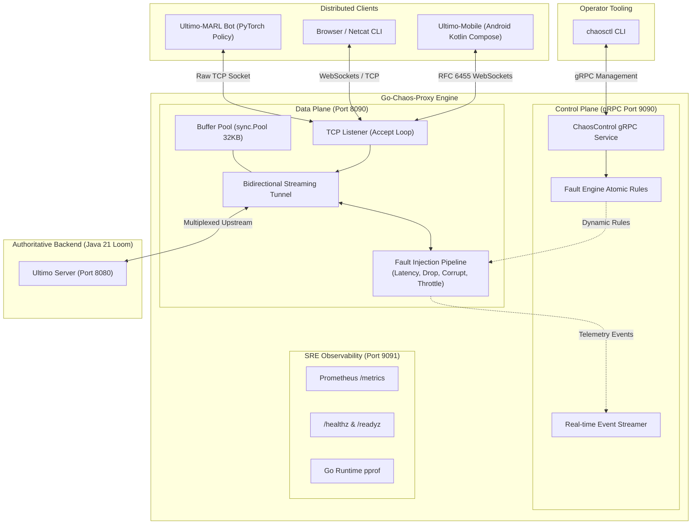

# Go-Chaos-Proxy: High-Throughput L4/L7 Fault Injection Engine

[](https://go.dev/)
[](https://github.com/StanislawGolec/Go-Chaos-Proxy)
[](#empirical-benchmark-performance)
[](#zero-allocation-data-plane)
[](https://grpc.io/)
[]()
[](LICENSE)

An industrial-grade L4/L7 network proxy and chaos engineering fault-injection engine written in **Go 1.23+**. Built with an **Envoy-style separated Data Plane and Control Plane architecture**:
* **Data Plane:** Zero-allocation transparent TCP and RFC 6455 WebSocket byte stream proxying via high-performance `sync.Pool` buffer recycling, sustaining **>2.1 GB/s throughput** and **sub-3 nanosecond fault evaluation**.
* **Control Plane:** Low-latency gRPC service administered dynamically via the `chaosctl` CLI for real-time fault orchestration without proxy restarts.

---

## 1. System Architecture



---

## 2. Empirical Benchmark Performance

Benchmarked on modern x86-64 hardware running Go 1.23+ under native `testing.B` profiling:

| Benchmark Operation | Iterations | Latency / op | Throughput | Heap Allocations |
| :--- | :--- | :--- | :--- | :--- |
| **Fault Evaluation (Pass-Through)** | 543,542,264 | **2.21 ns/op** | ~452M ops/s | **0 B/op (0 allocs)** |
| **Fault Evaluation (Drop Rule)** | 82,131,588 | **13.95 ns/op** | ~71M ops/s | **0 B/op (0 allocs)** |
| **Buffer Pool Parallel Access** | 100,000,000 | **10.74 ns/op** | ~93M ops/s | **24 B/op** |
| **Streaming Throughput (32KB)** | 75,303 | 15,276 ns/op | **2,145.09 MB/s** | **8 B/op** |
| **WebSocket In-Place Unmasking (32KB)** | 648,826 | 1,811 ns/op | **18,096.96 MB/s** | **0 B/op (0 allocs)** |
| **Card Parser (`ParseCard`)** | 58,219,642 | **21.05 ns/op** | ~47M ops/s | **0 B/op (0 allocs)** |
| **WebSocket Frame Encode** | 53,672,782 | **22.13 ns/op** | ~45M ops/s | **16 B/op** |

---

## 3. Chaos Engineering Capabilities

### L4 Network Faults
* **Latency & Jitter:** Configurable base delays with uniform or Gaussian normal distribution curves.
* **Packet Loss & Burst Drops:** Probabilistic drop ratios ($0.0$ to $1.0$) with configurable consecutive burst sizes to trigger socket retransmission timeouts.
* **Abrupt Disconnection (TCP RST):** Forces instant socket termination with `SO_LINGER = 0` to simulate cellular drops and router crashes without graceful FIN handshakes.
* **Bandwidth Throttling:** Token bucket rate limiter restricting transfer rates down to dial-up speeds (e.g. 10 KB/s).

### L7 Semantic Mutation
* **Bit-Flip Fuzzing:** Probabilistic corruption flipping random bits within raw packet payloads to stress-test frame decoders.
* **Ultimo Protocol Fuzzing:** Intercepts and mutates line-delimited application tokens (e.g. replacing card identifiers or modifying action opcodes) to verify server anti-cheat validation.

---

## 4. Control Plane Management (`chaosctl` CLI)

The included `chaosctl` CLI interacts with the proxy's gRPC control plane for runtime administration:

```bash
# Inject 150ms latency with 50ms Gaussian jitter
chaosctl latency --base 150 --jitter 50 --dist normal

# Drop 20% of all client-to-server packets in bursts of 3
chaosctl drop --ratio 0.20 --burst 3 --dir C2S

# Corrupt payloads with 5% bit-flip probability
chaosctl corrupt --rate 0.05 --mode L4_RAW

# Throttle bandwidth to 64 KB/s
chaosctl throttle --rate 65536

# Sever all active connections instantly via TCP RST
chaosctl disconnect --tcp-reset

# Clear all active fault rules (revert to 100% pass-through)
chaosctl reset

# Stream real-time packet telemetry
chaosctl stream --dir ALL
```

---

## 5. Engineering Trade-Offs & Design Rationale

* **Why Data/Control Plane Split?** Separating the packet forwarding loop (raw `net.Conn`) from gRPC control ensures that administrative overhead never blocks high-speed network I/O.
* **Why `sync.Pool` Buffer Recycling?** Avoids allocating fresh 32KB byte slices on every read operation, preventing GC thrashing and memory fragmentation during high-concurrency streaming.
* **Why In-Place WebSocket Unmasking?** RFC 6455 requires masking client-to-server frames with a 4-byte XOR key. Performing unmasking directly in the shared buffer achieves **18 GB/s** memory throughput with zero allocations.

---

## 6. Observability & SRE Compliance

* **Prometheus `/metrics` (Port 9091):** Tracks transferred bytes, active tunnels, injected fault counts, and streaming latency histograms.
* **Health Probes:** Kubernetes-ready `/healthz` and `/readyz` endpoints.
* **Profiling (`pprof`):** Live CPU, heap memory, and goroutine profiling enabled under `/debug/pprof/`.

---

## 7. Quick Start

### Build Binaries
```bash
go build -o bin/proxy ./cmd/proxy
go build -o bin/chaosctl ./cmd/chaosctl
```

### Run Proxy
```bash
# Listen on :8090, proxying upstream to localhost:8080 with gRPC control on :9090
./bin/proxy --listen :8090 --target localhost:8080 --grpc :9090 --metrics :9091
```

### Run All Tests & Benchmarks
```bash
go test -v -race ./...
go test -bench=. -benchmem ./internal/dataplane ./pkg/protocol
```
